 

Ingeniero en Sistemas Informáticos por la Universidad de El Salvador (FMO).
Me dedico a construir aplicaciones web y a la gestión de riesgos: que un sistema funcione es la mitad del trabajo, la otra mitad es anticipar dónde puede fallar y qué pasa cuando falla.

Mi trabajo más reciente es el sistema de gestión de **Villamotos**, ya implementado y en uso. Lleva el inventario, las ventas, los créditos y las cuotas del negocio.

 

**Ahora mismo**

- Dando soporte y nuevas funciones al sistema de Villamotos.
- Desarrollando [MotoStock](https://github.com/EliseoSantos2468/MotoStock), un sistema de inventario, ventas y créditos para un negocio de motos y repuestos.
- Aprendiendo más sobre despliegue con Docker y monitoreo de servidores.

 

**Proyectos**

**[MotoStock](https://github.com/EliseoSantos2468/MotoStock)**\
Inventario, ventas, préstamos y cuotas, con roles y API propia.\
`Laravel 12` `PostgreSQL` `Tailwind` `Docker`

**[DATACENTER-SIDESI-ACC](https://github.com/edraslazo/DATACENTER-SIDESI-ACC)**\
Simulación de un centro de datos: firewall con iptables, DHCP y DNS redundantes, NAS, AAA y monitoreo con Zabbix.\
`Docker Compose` `Linux`

**[SistemaContable-2023](https://github.com/edraslazo/SistemaContable-2023)**\
Libro diario, libro mayor y balance de comprobación con interfaz gráfica.\
`Java` `PostgreSQL`

**[WeatherApi](https://github.com/edraslazo/WeatherApi)**\
Clima actual de ciudades de El Salvador con datos de OpenWeatherMap.\
`JavaScript`

**[MBROS_LIBRARY](https://github.com/edraslazo/MBROS_LIBRARY)**\
Librería de componentes y utilidades CSS con temática de Mario Bros.\
`Sass`

 

**Herramientas**

 

**Contacto**

[edraslazo503@gmail.com](mailto:edraslazo503@gmail.com) · [+503 7891 9521](https://wa.me/50378919521)
